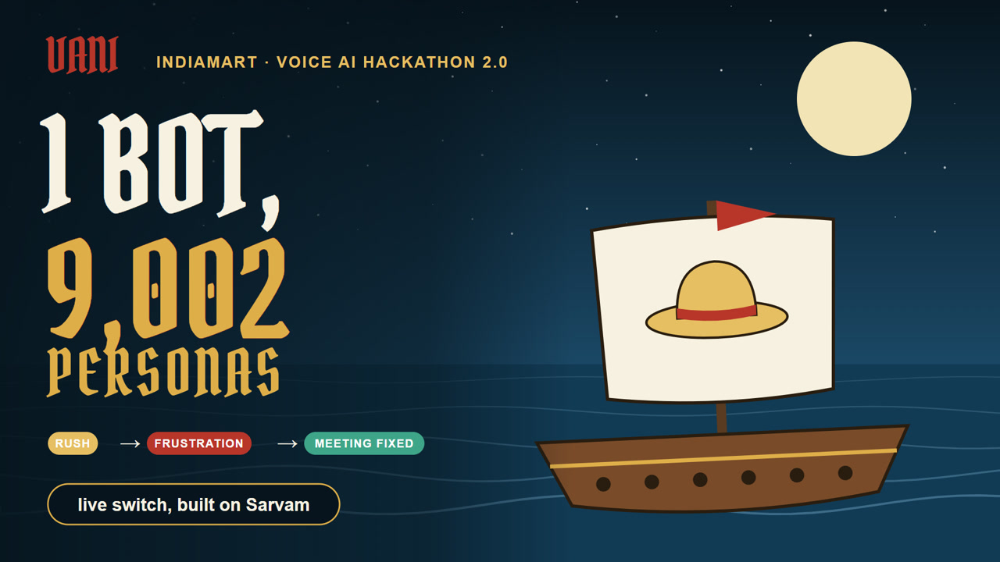

# VANI Persona Voyage

**Team Straw Hat Pirates · IndiaMART Voice AI Hackathon 2.0 · Problem 4: Persona Design**

VANI, IndiaMART's meeting-fixing voice bot, used one voice and one script for every seller. This project gives every seller their own evidence-backed VANI persona before the call, and switches VANI's delivery during the call when the seller is rushed, annoyed, confused, interested or changes language. It is built and running on Sarvam Voice Agents.



## Deliverables

| Deliverable | Where |
|---|---|
| Persona generator running on seller files | `persona/` (`python -m persona.cli --seller-id <id>` or `--all`) |
| Persona spec per seller, with the reason for each choice | `outputs/personas/*.json`: the six demo sellers, IDs masked. Every setting is `{value, reason, evidence, confidence, source}` |
| Live demo with mid-call switches on Sarvam | Six agents in Sarvam workspace "VANI" (IDs in `sarvam_agent/agents.json`); demo video linked on the submission page |
| Switch log | Written by the Sarvam code tool `sarvam_agent/update_persona_mode.py` into the call variable `live_switch_log` (turn, signal, the seller's words, detected by, from → to) |
| One-slide presentation | `docs/one_slide.html` |
| Architecture | `docs/architecture_map.html` (what runs where), `docs/architecture.html` (detail) |

## How it works

1. **Evidence** (`evidence/`): meeting-fix rate for each choice VANI can make, measured on 2,69,455 past calls with 95% Wilson confidence intervals stratified by lead type, and tagged strong / moderate / weak / informed guess. Output: `outputs/evidence.json` (145 records) and `outputs/evidence_report.md`.
2. **Signal detector** (`live/lexicon.py`, `evidence/signals_eval.py`): a Hinglish lexicon plus the LLM, scored against 2,986 audited seller turns. Output: `outputs/signals_eval.json`.
3. **Persona generator** (`persona/`): 23 evidence-cited rules plus a manual-override feed that outranks them (`manual/`). Every one of 1,49,363 sellers gets a spec; there are 9,002 distinct configurations (`outputs/distinctness.json`).
4. **Routing to Sarvam** (`sarvam_agent/`): each seller goes to one of six agents (voice and pace live in the agent), carrying 17 persona variables. `prompt.md` is the shared agent prompt.
5. **Live switch on Sarvam** (`sarvam_agent/switch_tool_template.py` → `update_persona_mode.py`): fuses the LLM's guess with the lexicon (Devanagari is transliterated for phone STT), applies a fixed priority and a two-turn cooldown, changes language when needed, returns the next reply's mode, and logs the switch. Replayed on 290 audited calls, it is in the right mode on the labelled turn for frustration 72%, rush 65%, confusion 34% and interest 30%, with zero flip-flopping (`evidence/switch_replay.py` → `outputs/switch_timing.json`).
6. **Persona Service** (`service/`): FastAPI for nightly generation, routing, campaign push, the Sarvam on-start hook and call-end webhook, a review queue, and a one-page dashboard (`service/control/index.html`). See `service/GUIDE.md`.

## Run it

```
python -m venv .venv && .venv\Scripts\pip install -r requirements.txt
copy .env.example .env                                # add your Sarvam keys
python -m data.loader                                  # needs the PS07 dataset (not included)
python -m evidence.features && python -m evidence.miner && python -m evidence.signals_eval
python -m persona.cli --all                            # personas for every seller
python -m pytest -q tests                              # 28 tests
start_control_room.bat                                 # dashboard on http://localhost:8080
```

## Not included

The IndiaMART PS07 dataset and anything derived per seller (cached tables, all 1,49,363 personas, call recordings and transcripts) are internal and not in this repo. Demo persona specs have seller IDs masked, and lines quoting past calls are removed. The six seller IDs used as demo defaults still appear in the code.

## Video

`video/` renders the explainer: animated scenes in `stage.html`, Sarvam Bulbul narration from `tts.py`, and `assemble.py` to build the MP4. The theme is an original pirate voyage, not affiliated with any franchise.
